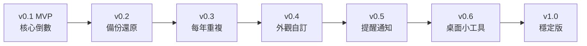
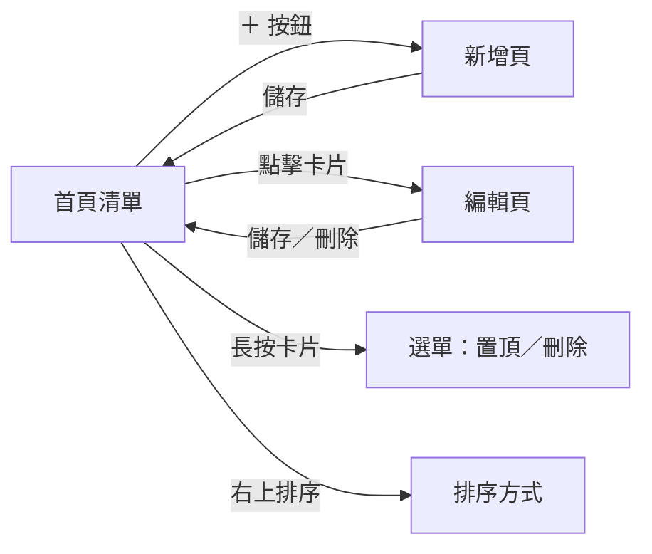

# D-Day Before（輕量版）開發計畫書

## 1. 背景與目標

原本使用的「TheDayBefore」APP 功能即將結束，需要一款**自用、輕量、離線**的 D-Day 倒數 APP 取代。

**核心原則**
- **輕量**：只做常用功能，不做帳號、雲端、廣告、社群、主題商店
- **離線**：資料只存在手機本機，不要求網路權限
- **快速**：開啟後馬上看到所有 D-Day，新增一筆不超過 3 步

**技術選型**

| 項目 | 選擇 | 理由 |
|---|---|---|
| 框架 | Flutter 3.44（Dart 3.12） | 本機已安裝，可產出 Android APK |
| 平台 | Android | 原 APP 使用環境（相容 Android 15+ Edge-to-Edge） |
| 資料儲存 | `shared_preferences`（限定傳統 XML `SharedPreferences`） | 單一 JSON 字串含 `schemaVersion`，資料量小不需資料庫，且方便 v0.6 原生 Kotlin 小工具直接讀取 |
| UI 與語系 | Material 3 + SDK 內建 `flutter_localizations` | 繁體中文（`zh_TW`）日期選擇器與介面，無第三方依賴 |
| 套件／顯示名稱 | `com.cytsa.dday_before` / `D-Day Before` | 可依需求調整 |
| 簽章策略 | v0.1 裝機前建立固定 release keystore | 金鑰與 `key.properties` 排除於 git；避免日後改簽章導致無法覆蓋升級而遺失本機資料 |

---

## 2. 版本目標總覽



| 版本 | 主題 | 內容 | 狀態 |
|---|---|---|---|
| **v0.1** | MVP 核心 | 新增／編輯／刪除、D-N／D+N、當天算第 1 天、置頂、完整排序規則、繁中日期選擇器、跨午夜前景自動更新、固定 release 簽章與 App 名稱 | 已完成 |
| v0.2 | 資料安全 | 匯出／匯入 JSON 備份檔（含 `schemaVersion` 檢查與合併／覆蓋策略） | 已完成 |
| v0.3 | 重複紀念日 | 每年重複（生日、紀念日），自動跳到下一次；預定 `2/29` 在平年改算 `2/28` | 本次實作 |
| v0.4 | 外觀自訂 | 每筆 D-Day 自訂卡片配色、深色／淺色模式；背景圖不併入純 JSON 備份，列為選配或延後 | 規劃中 |
| v0.5 | 提醒通知 | 當天／前 N 天提醒通知、通知列常駐顯示（註：需處理 Android 13+ `POST_NOTIFICATIONS` 動態權限、Android 14+ 常駐通知可被手動滑掉、重開機 `RECEIVE_BOOT_COMPLETED` 重建排程與省電限制） | 規劃中 |
| v0.6 | 桌面小工具 | 主畫面 Widget，由原生 Kotlin `AppWidgetProvider` 直接讀取 XML `SharedPreferences` 並重算天數 | 規劃中 |
| v1.0 | 穩定版 | 專屬 APP 圖示、啟動頁與細節打磨、正式 release APK | 規劃中 |

> [!NOTE]
> 已將「資料安全（JSON 備份還原）」提前至 **v0.2**，確保開始長期記錄真實資料後，換機或重裝都有可靠的還原機制。

---

## 3. v0.1 MVP 詳細規格（本次實作範圍）

### 3.1 功能清單

| # | 功能 | 說明 |
|---|---|---|
| F1 | 新增 D-Day | 輸入標題（`trim()` 後不可空白、上限 50 字）、繁中日期選擇器（範圍 `1900-01-01` ～ `2100-12-31`）、計算方式開關 |
| F2 | 編輯 D-Day | 點擊卡片進入編輯頁；有未儲存修改返回時跳出確認對話框 |
| F3 | 刪除 D-Day | 編輯頁刪除按鈕與首頁長按選單的「刪除」皆附確認對話框 |
| F4 | D-N／D+N 顯示 | 未來顯示 `D-N`，當天顯示 `D-Day`，過去顯示 `D+N` |
| F5 | 當天算第 1 天 | 「紀念日模式」，起始日當天顯示「第 1 天」，尚未開始顯示 `D-N` |
| F6 | 置頂 | 長按選單切換置頂；置頂項目永遠在最上方，**多筆置頂項目之間**同樣套用當前排序規則 |
| F7 | 排序 | 可切換三種排序方式並記住偏好（詳見下方排序規則） |
| F8 | 本機保存與容錯 | 每次變更立即寫入；讀取遇到 JSON 毀損或單筆欄位異常時安全降級，不可閃退 |
| F9 | 跨午夜自動刷新 | 透過 `WidgetsBindingObserver` 監聽 `AppLifecycleState.resumed`，並設隔日 `00:00` `Timer`，確保重開、背景回前景或停留跨午夜皆自動重算天數 |

**排序規則（F7 詳細定義）**

所有排序皆先將「置頂項目」排在最上方，置頂區與非置頂區各自依下列規則排序：

1. **距離今天最近（預設）**：分兩組，今日與未來（`diff >= 0`）排在上方，依 `diff` 升冪（`D-Day` → `D-1` → `D-30`）；已過去（`diff < 0`）排在下方，依距離由近到遠（`D+1` → `D+5` → `D+500`）。
   > 註：開啟「當天算第 1 天」且起始日在過去的卡片屬於過去分組，常看項目可搭配置頂固定於最上方。
2. **日期先後**：依目標日期升冪（舊 → 新）。
3. **建立時間**：依 `createdAt` 降冪（最新建立在上）。

- **平手規則**：比較值相同時，依 `createdAt` 降冪，再依 `id` 升冪確保排序結果穩定一致。

### 3.2 天數計算規則

只比較「日期」，忽略時分秒，以手機本地時區的午夜為界。

> [!IMPORTANT]
> 為避免日光節約時間（DST）造成單日 23 小時使 `difference().inDays` 少算 1 天的問題，實作上必須先擷取本地日期的 `(year, month, day)`，再轉為 `DateTime.utc(y, m, d)` 後相減計算天數差。

設 `diff = 目標日 − 今天`（天）：

| 計算方式 | 條件 | 顯示 | 範例（今天 11/25） |
|---|---|---|---|
| 倒數／經過（預設） | `diff > 0` | `D-{diff}` | 目標 12/25 → `D-30` |
| | `diff = 0` | `D-Day` | 目標 11/25 → `D-Day` |
| | `diff < 0` | `D+{-diff}` | 目標 11/20 → `D+5` |
| 當天算第 1 天 | 起始日 ≤ 今天 | `第 {今天 − 起始日 + 1} 天` | 起始 11/25 → `第 1 天` |
| | 起始日 > 今天 | `D-{diff}`（尚未開始） | 起始 11/30 → `D-5` |

### 3.3 畫面



- **首頁**：卡片清單，每張卡片顯示「標題、目標日期（繁中含星期，如 `2026/12/25 (五)`）、大字天數顯示」，置頂項目有圖釘標記；無資料時顯示空狀態提示；長按選單的「刪除」亦跳確認對話框；清單底部保留安全間距以相容 Android 15+ Edge-to-Edge（避免最後一張卡片被系統導覽列或 FAB 遮擋）。
- **新增／編輯頁**：標題輸入框（驗證不可為空或純空白，上限 50 字）、繁體中文（`zh_TW`）`showDatePicker` 日期選擇器（`1900-01-01` ～ `2100-12-31`）、「當天算第 1 天」開關、即時預覽計算結果；編輯有變更欲返回時提示確認是否放棄修改。

### 3.4 資料結構

本機儲存採用傳統 XML `SharedPreferences`（透過 `shared_preferences` 套件），使用兩個 key：
- `dday_items_v1`：儲存含 `schemaVersion` 的 JSON 字串
- `dday_sort_mode`：儲存目前選用的排序模式字串

`dday_items_v1` 格式範例：

```json
{
  "schemaVersion": 1,
  "items": [
    {
      "id": "550e8400-e29b-41d4-a716-446655440000",
      "title": "期末考",
      "date": "2026-12-25",
      "countFromOne": false,
      "pinned": false,
      "createdAt": "2026-11-25T07:40:00.000Z"
    }
  ]
}
```

- **`id`**：隨機 UUID v4 字串（零外部依賴實作），避免毫秒時間戳在快速建立、測試或匯入時碰撞。
- **`date`**：純日期 `"YYYY-MM-DD"`，不帶時區，跨時區旅行不跑偏。
- **`createdAt`**：一律存 UTC ISO-8601 字串（結尾 `Z`，由 `toUtc().toIso8601String()` 產生）。
- **擴充與容錯**：反序列化時忽略未知欄位，並對未來欄位（如 v0.3 `repeatYearly`、v0.4 `color`）預留安全預設值；遇到單筆資料缺欄或 JSON 格式損毀時安全降級，不造成閃退。

### 3.5 開發前置與建置規範

- **本機環境前置**：執行 `flutter doctor --android-licenses` 完成 Android SDK 授權。
- **Android 專案設定**：
  - 將 `android/app/src/main/AndroidManifest.xml` 的 `android:label` 設為 `D-Day Before`。
  - 建立本機固定 release keystore 與 `android/key.properties`（兩者皆加入 `.gitignore`，嚴禁進版控），並於 `android/app/build.gradle.kts` 載入 release 簽章設定。
- **建置指令**：使用 `flutter build apk --release --target-platform android-arm64 --split-debug-info=build/debug_info` 產出精簡的單架構 release APK。

### 3.6 驗收標準

- [x] 新增、編輯（含未儲存返回確認）、刪除（編輯頁與長按選單皆有確認對話框）後重開 APP，資料正確保留
- [x] 表單驗證（空標題攔截、50 字上限）與繁中日期選擇器（1900–2100）運作正常
- [x] 單元測試全數通過：
  - 天數計算：今天、明天、昨天、跨月、跨年、閏年 2/29、DST 安全計算、「當天算第 1 天」
  - 排序邏輯：三種排序模式、多筆置頂、平手規則
  - 模型與儲存：`schemaVersion`、JSON 序列化／反序列化、缺少選填欄位與損毀 JSON 容錯
- [x] 跨午夜更新：重開 APP、背景回前景（`resumed`）與停留跨過 `00:00` 皆自動更新天數
- [x] Release APK（arm64）小於 20 MB（實測 v0.1 約 16.9 MB，含 Flutter 3.44 未壓縮 arm64 引擎以相容 16 KB 分頁）、使用固定正式簽章，且檢查 release APK 權限確認不含 `android.permission.INTERNET`
- [x] `flutter analyze` 與 `flutter test` 零錯誤

---

## 4. 專案結構（v0.1）

```
lib/
├── main.dart              # 進入點、Material 3 主題、zh_TW 語系設定
├── models/dday.dart       # 資料模型、UUID 產生與容錯 JSON 轉換
├── utils/
│   ├── day_calc.dart      # 天數計算（純函式，UTC 日期相減）
│   └── dday_sorter.dart   # 排序與置頂邏輯（純函式）
├── data/dday_store.dart   # 本機 XML SharedPreferences 讀寫（含 schemaVersion）
└── screens/
    ├── home_screen.dart   # 首頁清單、生命週期與跨午夜自動刷新
    └── edit_screen.dart   # 新增／編輯頁、驗證與未儲存離開確認
test/
├── day_calc_test.dart     # 天數計算單元測試
├── dday_sorter_test.dart  # 排序與置頂單元測試
└── dday_store_test.dart   # 模型與本機儲存單元測試
```

---

## 5. 不做的事（明確排除）

- 帳號登入、雲端同步
- 廣告、付費功能
- 農曆日期（如後續有需要再評估納入 v0.3 之後）
- 背景圖打包進純 JSON 備份（維持輕量純文字備份）
- iOS 版本

---

## 6. 備註與開工確認

本次已將計畫審查的結論（預設排序與平手規則、備份提前至 v0.2、固定 release 簽章、DST 與跨午夜刷新、資料結構 `schemaVersion` 與 UUID）全數定案納入本計畫書。

若對目前的名稱（`D-Day Before`）、套件識別碼（`com.cytsa.dday_before`）與上述規格無其他調整，即可直接進入 **v0.1 實作階段**。
